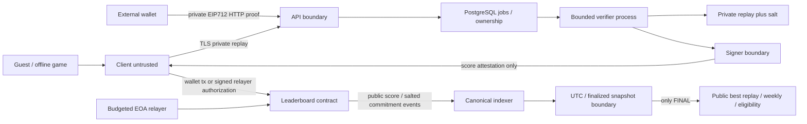

# T006 — Threat model kompetisi

Tanggal: 2026-11-05. Scope: guest/API/verifier/private storage/signer/contract/relayer/indexer/finalizer. Status: design review, belum audit implementasi/contract dan belum G4.

## Aset dan trust assumption

Lindungi solusi pemain sampai FINAL, fairness best-score/rank/points, identity wallet, signer/admin/relayer keys, sponsor budget, historical snapshot integrity, dan offline guest data. Client/replay/import/RPC/provider metadata selalu input tidak tepercaya. Off-chain verifier, challenge publisher, dan final snapshot publisher **dipercaya** menghitung aturan/eligibility dengan benar; blockchain memvalidasi signature/bindings, bukan membuktikan engine atau ranking secara mandiri.

## Abuse matrix dan pemilik kontrol

| Boundary/ancaman | Kontrol baseline | Pemilik implementasi dan bukti |
|---|---|---|
| Wallet string spoof / replay API authorization | EIP712 ApiAuthorization mengikat wallet+audience+method+path+bodyHash+server nonce+expiry; consume nonce atomik | T059; wrong-wallet/nonce/cross-route tests T066 |
| Token theft / third-party cookie block | Tidak memakai cookie session; one-record RAM capability hash at rest, 15min, no replay raw, reauthorize recovery; headers/no-store/no logs | T059/T065; iframe/browser tests T004/T066 |
| Client menulis score sendiri / forged replay | Frozen spec/version, normalized deterministic resimulation, computed score, unknown version rejected | T058; golden parity G2 dan mutated replay T066 |
| Hash mismatch / commitment brute force | Canonical integer JSON; puzzle SHA256; replay public commitment dengan secret salt32 hingga FINAL | T002/T058/T060; hash vectors dan pre-reveal leak review |
| Request DoS / decompression bomb / solver exhaustion | Strict byte/depth/topology/tick caps, no compressed HTTP body, bounded queue/process wall time; no solver di submission route | T007/T059; boundary/property/load tests |
| Replay leak melalui public API/storage/CDN/log/analytics | Private store ACL, no public URL/actions/salt/unsalted hash, explicit FINAL gate, no-store, payload redaction | T059/T064/T085/T088; access matrix + log/calldata inspection |
| Operator storage/key compromise | Separate identities, encryption at rest/backup, secret adapter, least privilege, signer/admin/relayer key separation | T074; key config/rotation dry run; deployment controls later |
| EIP712 cross-chain/contract/version replay | Domain chain+contract; registered puzzle/engine/rules hashes; nonce per wallet/challenge; deadline+epoch | T060/T067/T073; mutate every binding vector |
| Relayer bertindak untuk wallet lain / arbitrary calls | Independent wallet SubmitAuthorization binds full attestation digest+executor+nonce+expiry; score entrypoints fixed, value0 | T070/T073; wrong-wallet/executor/target tests |
| Sponsor budget race / retries / Sybil | DB row locks fixed order; worst-case reservations+settled costs; one successful wallet/day; failed/pending lifecycle explicit; global cap+rate limits | T070/T076; concurrent fake-relayer load. Sybil residual remains |
| Mempool tx terlambat / local clock manipulation | On-chain start<=block.timestamp<endExclusive authoritative; API receipt time tidak memberi grace; server UTC metadata | T057/T067/T075; deadline boundary tests |
| Challenge hash/window changed after publication | Owner-only preregister immutable record before start; cancelled flag/pause bukan overwrite; no active replacement | T057/T067; mutation/admin tests |
| Score best/rank tidak adil | Strict lexicographic best/wallet; shared competition ranks; canonical projection and global-count indexed pagination; no timestamp tie-break | T062/T072/T079; ties across pages/snapshot tests |
| Reorg / duplicate logs / RPC lies | Number+hash+parent cursor, idempotent logs, rollback/backfill; finalized-tag cutoff+complete projection; provider disagreement halts | T063/T071/T072/T086; two-branch/finality incident tests |
| Premature reveal / weekly points / achievement | One immutable final snapshot source; no active/provisional replay, points or eligible attestation; registry registered final source snapshots | T063/T064/T079/T081/T082; rollover/finality tests |
| Signer compromise / epoch drift | Emergency pause, immediate signerEpoch invalidation, two-step owner, key separation/monitoring, rotate/reissue before deadline | T067/T074/T077; old/new epoch tests and incident runbook |
| Achievement duplicate/wrong wallet/finality replay | Separate domain/registry, bound evidence+finalitySet, registered source snapshots, nonce/expiry, one claim wallet/achievement | T081/T082; duplicate/multi-wallet/multi-chain tests |
| Wallet provider/XSS/dependency supply chain | JS interop typed boundaries, untrusted icons rendered safely, no innerHTML/eval, exact dependency pins+lockfile+license checks, no session secrets in persistent client storage | T068/T095; provider mock/browser/lock review |
| Chain/backend outage menghapus progress | Offline guest paths independent, preserve local program; pending tx lookup before retry, no success on timeout | T028/T048/T075; offline/restart suite |

Task T095 pada master hardening adalah review keamanan. Menyebut task bukan bukti kontrol sudah diterapkan.

## State dan privacy invariants

1. Tidak ada public action list, salt atau private HTTP body/signature sebelum challenge FINAL; wallet/RPC hanya menerima score metadata/commitment.
2. Attestation tanpa accepted canonical chain event tidak masuk official leaderboard. Rank/weekly tidak dihitung di contract dengan scan seluruh pemain.
3. Signer hanya menandatangani verified durable replay record; payload seluruh field cocok frozen challenge dan authenticated owner.
4. Setiap sponsor mutation memiliki signed wallet intent dan reserved budget; pending result tidak dianggap failed lalu dibroadcast ganda.
5. Semua output final memakai snapshot hash/version yang sama; finalization incident menahan reveal/claims dan tidak menyembunyikan history.
6. Guest dapat bermain/menyimpan progress tanpa wallet/API; backup `.szsave` tidak memuat capability, attestation auth session, private key, seed phrase, atau signer secrets.

## Batas residual yang tidak diselesaikan signature

Trusted verifier/publisher dapat salah atau berbohong; public spec/golden tests, signer separation dan post-final replay audit memberi pemeriksaan, bukan trustless proof. Pemain dapat mempublikasikan solusi sendiri di luar aplikasi; API hanya melindungi data yang dikelolanya. Kuota wallet tidak menghalangi banyak wallet satu orang. Skor publik dapat memberi informasi parsial tentang solusi, tetapi salted commitment mencegah lookup langsung action list kecil. Hash puzzle preregistration sendiri tidak menyembunyikan candidate dari katalog kecil yang dapat ditebak; Daily memakai private CSPRNG256bit seed dan tidak menjanjikan kerahasiaan kriptografis dari hash tanpa salt. Hosting/DB/root compromise memerlukan operational incident response; belum ada klaim deployment hardening lulus.

Sumber primitive yang diverifikasi: [EIP-712 replay caveat](https://eips.ethereum.org/EIPS/eip-712#security-considerations), [EIP-1193 security](https://eips.ethereum.org/EIPS/eip-1193#security-considerations), [EIP-6963 security](https://eips.ethereum.org/EIPS/eip-6963#security-considerations), [OpenZeppelin crypto](https://docs.openzeppelin.com/contracts/5.x/api/utils/cryptography), [Base finalized block API](https://docs.base.org/base-chain/api-reference/ethereum-json-rpc-api/eth_getBlockByNumber). Tabel mitigasi/limit adalah keputusan proyek yang harus diuji, bukan jaminan dari sumber tersebut.
