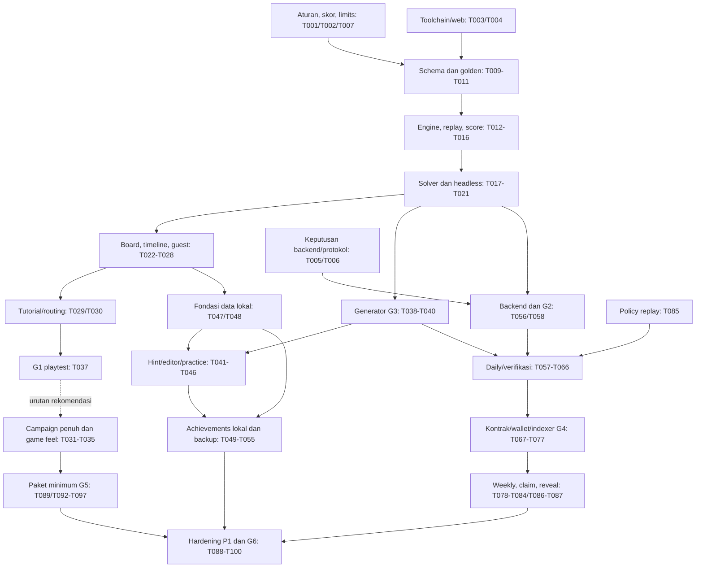

# SIGNAL ZERO — Rencana implementasi untuk agent/AI

Sumber: [SIGNAL_ZERO_PRD_v2.2.md](../SIGNAL_ZERO_PRD_v2.2.md), versi 2.2, 5 November 2026. PRD tetap menjadi baseline requirement; dokumen ini memecah pekerjaan, bukan mengubah keputusan produk atau mengimplementasikan game.

## Mulai di sini

1. Buka [todo.md](todo.md) dan pilih task yang seluruh dependensinya sudah `done`.
2. Baca kartu lengkap pada file fase yang ditautkan, bagian PRD yang dirujuk, serta keputusan/evidence dependensinya.
3. Berikan satu kartu kepada satu agent memakai [agent-task-template.md](agent-task-template.md).
4. Verifikasi acceptance criteria, simpan evidence, lalu perbarui status. Jangan menandai implementasi selesai hanya karena kode telah ditulis.

**Hasil breakdown:** 100 task parent T001–T100, sembilan kelompok, ukuran S/M, dengan sumber PRD, output rencana maksimal lima file, dependensi, tiga acceptance criteria, serta skenario verifikasi masing-masing. Folder awal hanya berisi PRD. Status terbaru: **Fase 01/T001–T008 selesai**, dengan laporan [phase-01.md](evidence/phase-01.md); Fase 02–09 belum diimplementasikan. T004 dijalankan dalam dua slice T004a/T004b agar implementasi probe dan verifikasi runtime tetap terpisah.

**Path setelah keputusan fondasi:** domain produksi dan tes headless berada di `packages/puzzle_domain`, dipakai bersama Flutter dan verifier Dart. Path awal `apps/game/lib/domain` pada kartu fase selanjutnya adalah usulan sebelum keputusan T005; saat eksekusi, arahkan logika domain ke package bersama, UI tetap di app, dan jangan membuat engine kedua. Detail sumber/schema tetap mengikuti masing-masing task; konstanta versi di package saat ini belum merupakan engine.

## Batas scope dan prioritas

| Jalur | Isi | Kriteria penggunaan |
|---|---|---|
| P0 | Engine/SHIFT/timeline/score/solver, 15 level, guest offline, procedural visual, paket playable | Gameplay minimum menurut §13; selesaikan sebelum investasi besar di chain |
| P1 | Generator, hints, editor/share, backup, Daily/Weekly, wallet/sponsor, achievements, accessibility, diagnostics | Ambitious Release; boleh diparalelkan setelah kontrak dan core siap |
| P2 | Replay sharing dan advanced procedural audio | Opsional; tidak memblokir G5/G6 |

Beberapa task persiapan/P0 tidak memiliki FR tersendiri: keputusan aturan, tooling, kompatibilitas web, audio procedural dasar, dan packaging berasal dari bagian arsitektur/NFR/visual-audio/rilis PRD. FR-022 **advanced** audio tetap P2. T036 dan T090 tetap P1 sesuai FR-023; baseline bentuk/label/keterbacaan sudah masuk board/kontrol P0. Tidak ada task P0 yang membutuhkan penyelesaian task P1.

Tidak menambahkan token, NFT, trading, pay-to-win, multiplayer real-time, backend wajib untuk bermain, atau wallet wajib. Backend language/database/provider, wallet SDK, resource limits, collision/sync/special nodes, dan rumus actions yang belum final harus diputuskan melalui task keputusan. Detail dokumen sumber diperlakukan sebagai requirement produk, bukan izin menjalankan deployment, transaksi berbayar, atau submission jam sekarang.

## Kelompok pekerjaan

| Kelompok | Task | Hasil utama | Kartu lengkap |
|---|---|---|---|
| 01 | T001–T008 | Aturan, versi, tooling, web spike, keputusan integrasi, limits, pemeriksaan jam | [Foundation](phases/01-foundation.md) |
| 02 | T009–T021 | Schema → engine → score → solver → satu puzzle headless | [Core engine](phases/02-core-engine.md) |
| 03 | T022–T037 | Satu puzzle playable → progress → tutorial/15 level → game feel | [Playable game](phases/03-playable-game.md) |
| 04 | T038–T046 | Generator valid → hints → editor → Share Code → practice | [Content dan creator](phases/04-content-creator.md) |
| 05 | T047–T055 | Perluasan Drift → achievements lokal → identity adapter → backup/restore | [Local data](phases/05-local-data.md) |
| 06 | T056–T066 | Daily immutable → verifier → attestation → shared rank → final/reveal | [Daily dan verifier](phases/06-daily-verifier.md) |
| 07 | T067–T077 | Contract → wallet → user-paid/sponsor → indexer/reorg → G4 | [Chain dan wallet](phases/07-chain-wallet.md) |
| 08 | T078–T087 | Weekly fairness/points → claim registry → replay viewer → integrasi P1 | [Tournament dan achievements](phases/08-tournament-achievements.md) |
| 09 | T088–T100 | Diagnostics/performance/accessibility/security → mobile/web → G5/G6; P2 | [Hardening dan release](phases/09-hardening-release.md) |

**Nomor kelompok bukan urutan eksekusi mutlak.** Contoh: T006 membutuhkan T007; T042/T045 membutuhkan T047; T059/T064 membutuhkan T085. Ikuti DAG dependensi, bukan nomor terkecil atau urutan paragraf. Checkpoint suatu kelompok dijalankan setelah task terkait selesai, meskipun pekerjaan di kelompok lain sedang berjalan.

## Urutan kerja yang disarankan

1. **Mulai paralel T001, T003, T008.** T001 menutup aturan; T003 membuktikan toolchain; T008 memeriksa aturan jam aktual. Lanjutkan T002/T007 dan T004 setelah dependensinya tersedia.
2. **Buktikan core.** T009–T021 membangun engine independen renderer, canonical program, golden vectors, solver terbatas, dan solusi puzzle. T022 shell dapat berjalan paralel; integrasikan board/timeline/controls T023–T028 sesegera mungkin.
3. **Uji satu alur bermain sebelum memperluas.** T029/T030 menyediakan tutorial dan contoh SHIFT; jalankan **T037 G1 lebih awal**, tanpa menunggu level 7–15 atau effects lengkap. Perbaikan hasil playtest menjadi task kecil tersendiri dengan dependensi jelas. Setelah G1, lanjutkan T031–T035 dan validasi seluruh 15 level. T036 adalah perluasan aksesibilitas P1.
4. **Prioritaskan risiko konten dan determinisme.** T038–T040 membuktikan generator (G3). Setelah T005/T006/T056 siap, T058 membuktikan client/verifier (G2), sebelum memperluas blockchain. T047 schema lokal boleh berjalan setelah T028; editor/hint/backup dibangun di atasnya.
5. **Integrasi kompetisi bertahap.** Kerjakan T085 policy replay sebelum intake. Jalur backend T056–T066 menggunakan fixture finality terlebih dahulu; T067–T077 menyambungkan wallet, kontrak, sponsor dan canonical chain. Attestation tanpa transaksi tidak masuk official rank.
6. **Tutup fitur P1.** T078 boleh dimulai lebih awal sebagai simulasi fairness. T079–T087 memakai daily final sebagai sumber weekly/achievement/reveal yang sama. T087 hanya kandidat integrasi, belum G6.
7. **Rilis sesuai bukti.** Jalur P0 berakhir pada T097/G5; T100/G6 membutuhkan P1 dan hardening lengkap. T098/T099 boleh ditunda. T093/iOS tetap pending jika toolchain Apple/perangkat belum tersedia; jangan meluluskan platform yang belum diuji.

PRD menyarankan G1–G3 diprioritaskan saat waktu sempit. G2 verifier dan G3 generator mengandung pekerjaan P1; **paket minimum P0 tidak otomatis berarti G1–G3 atau seluruh DoD PRD sudah lulus**. Nyatakan gate mana yang benar-benar selesai pada manifest build.

## Dependensi utama

Diagram adalah peta ringkas; **field Dependensi pada kartu adalah kontrak eksekusi**. Garis rekomendasi G1 tidak menjadi dependency cycle. Jangan menganggap rentang di diagram berarti setiap task di dalamnya bergantung pada seluruh rentang lain.

## Checkpoint dan release gates

Checkpoint CP-01A dan seterusnya ada di dokumen fase, umumnya setiap dua–tiga task. Pada setiap checkpoint, verifikasi output baru, tes yang relevan, dan satu alur terintegrasi; ulangi suite luas hanya bila ada perubahan/failure yang menuntutnya. Checkpoint bukan kewajiban berhenti meminta izin setiap tiga task.

| Gate PRD | Pemilik bukti | Bukti wajib |
|---|---|---|
| G1: SHIFT menyenangkan | T037; evaluasi ulang T097 | Playtest manusia, pemahaman/timing awal, temuan/keputusan owner; tidak dapat dibuktikan unit test |
| G2: client/verifier deterministik | T058, T066, T092 | Golden per-tick state/hash/score sama; daftar versi/platform yang diuji |
| G3: generator valid | T040 | Corpus/property tests reproducible; setiap puzzle terbit punya replay solusi; statistik unknown/reject |
| G4: competitive score tidak bisa dipalsukan | T077, review T095 | Adversarial E2E, signature/domain/nonce/window, canonical events, private actions; trust verifier tetap dinyatakan |
| G5: build jam playable | T097 | Semua P0, tutorial + 15 level, guest offline, artifact diuji, instruksi/rules jelas |
| G6: P1 stabil | T100 | T087 + hardening lengkap, seluruh P1/DoD terpetakan ke bukti, platform wajib yang belum diuji tetap blocker |

Target tutorial ≥80%, first success ≤5 menit, comprehension ≥80%, crash-free ≥99%, dan 60 FPS adalah target PRD. Catat sampel, perangkat, build mode, serta metode; tidak mengubahnya menjadi klaim keberhasilan dari bukti yang belum ada. Perubahan aturan/threshold memerlukan keputusan produk yang dicatat, bukan pelemahan AC diam-diam.

## Pembagian agent dan kepemilikan file

Setiap agent mengambil **satu task siap**. Pekerjaan dapat berlangsung paralel ketika output tidak bertabrakan dan dependensi selesai.

| Jalur agent | Contoh pekerjaan paralel | Hal yang harus dikoordinasikan |
|---|---|---|
| Domain/content | Engine, solver, generator, level fixtures | `specs/*`, rules, canonical encoding dan score; satu pemilik per kontrak |
| Game/UI | Board/timeline, tutorial, visual/audio | `app/router`, gameplay controller, shared visual tokens; satu pemilik perubahan pada waktu sama |
| Local/creator | Drift, backup, editor, share | T028 membuat database pertama; T047 memperluas database yang sama; jangan buat store kedua |
| Competition | API/verifier, contracts/indexer, wallet/tournament | Bekukan T006 dahulu; migrations, signer/domain dan event schema harus serial/terkoordinasi |

Contoh setelah core siap: agent A mengerjakan T038 generator, agent B T047 data, agent C T005 keputusan backend, agent D melanjutkan level/visual yang dependensinya lengkap. Sebelum itu, T001/T003/T008 adalah batch awal yang aman.

Migration sequence, schema/version contract, nonce/finality policy, dan file bersama tidak diedit bersamaan tanpa pembagian yang eksplisit. Path pada kartu merupakan usulan untuk repo baru; setelah scaffold, agent menyelaraskannya dengan file nyata, **memperluas implementasi yang sudah ada**, dan memperbarui path kartu jika berubah. Jangan menambah database, renderer, atau backend audio kedua hanya karena path usulan berbeda.

## Ukuran dan cara menutup task

- **S:** satu output sempit, umumnya 1–2 file produksi plus fixture/test. **M:** satu slice kecil, total sekitar 3–5 file. Ukuran bukan estimasi tanggal/jam yang dijanjikan.
- Satu sesi fokus, satu tujuan, maksimal tiga AC. T042 editor dan T070 sponsor rawan melebar: bila membutuhkan >5 file bermakna atau >1 sesi fokus, buat child task `T042a/T042b` atau `T070a/T070b`, wariskan AC, perbarui DAG/todo, lalu implementasikan satu child. Jangan menyembunyikan pekerjaan tambahan atau menurunkan AC.
- Scaffold/generated output tidak menjadi alasan memperluas scope fitur. Tes dipilih untuk membuktikan risiko nyata: golden/property untuk domain, fixture/fault injection untuk storage, integration untuk alur, fuzz/invariants untuk kontrak, browser/device runtime untuk UI/platform.
- Status task: `todo → in_progress → review → done`, atau `blocked` dengan alasan dan dependensi yang belum terpenuhi. Checklist hanya dicentang pada `done`; menulis rencana ini tidak mencentang task implementasi.
- Simpan evidence ke `tasks/evidence/Txxx.md` atau file laporan yang ditunjuk kartu. Catat command/scenario, versi, hasil, dan keterbatasan; link dari todo. Untuk keputusan/desain, evidence berupa spesifikasi yang disepakati + contoh yang diperiksa, bukan test aplikasi fiktif.
- Task selesai jika seluruh AC, verifikasi relevan, dan review output lulus; build/test yang tidak tersedia tetap pending. Saat blocked, simpan handoff dan pilih task independen yang siap.

## Keputusan terbuka dan risiko

| Masalah dari PRD | Task penutup | Dampak jika ditunda |
|---|---|---|
| Collision, sinkronisasi, special nodes, failure, tick boundary | T001 | Engine/solver/level saling bertentangan |
| Actions normalisasi, canonical hash/version, attempts, tick optimum achievement | T002 | Skor/verifier/replay/achievement berbeda |
| Limit graph/import/solver | T007 | Hang, resource abuse, klaim solvability palsu |
| Difficulty/kemiripan generator | T039/T040 | Konten trivial/repetitif meskipun valid |
| Backend/verifier runtime dan API/EIP-712 | T005/T006/T058 | Mismatch lintas bahasa, interface berubah di tengah implementasi |
| Wallet/sponsor SDK, otorisasi, budget dan retry | T006/T070/T076 | Relayer salah atribusi, kuota/biaya bocor |
| Replay private storage, retention, reveal | T085/T059/T064 | Solusi bocor sebelum final atau evidence terhapus |
| Finality/reorg dan koreksi snapshot | T006/T063/T071/T086 | Rank, weekly points dan claim tidak konsisten |
| Weekly fairness/table points | T078 | Bias jumlah peserta tidak dievaluasi; perubahan poin tidak boleh diasumsikan |
| Flutter web/SQLite/audio dan iOS toolchain | T004/T093/T094 | Build berhasil tetapi tidak playable/portable |
| Tema/deadline/AI policy jam belum diverifikasi | T008/T096 | Paket tidak sesuai aturan aktual |
| Contract/security trust dan signer ops | T073/T074/T095 | Signer dipercaya berlebihan, exploit atau klaim “audited” palsu |

Dokumen ini tidak menetapkan deadline atau tema Game Off, backend provider, gas budget, angka resource limits, atau pilihan SDK yang tidak ada di PRD. Hal tersebut merupakan output task keputusan, bukan fakta yang telah diverifikasi.

## Dokumen pendamping

- [todo.md](todo.md): checklist dan status seluruh task.
- [coverage.md](coverage.md): pemetaan FR, user stories, NFR, DoD ke task.
- [agent-task-template.md](agent-task-template.md): prompt satu task dan format handoff.
- [validation.md](validation.md): pemeriksaan konsistensi backlog; bukan bukti implementasi game.
